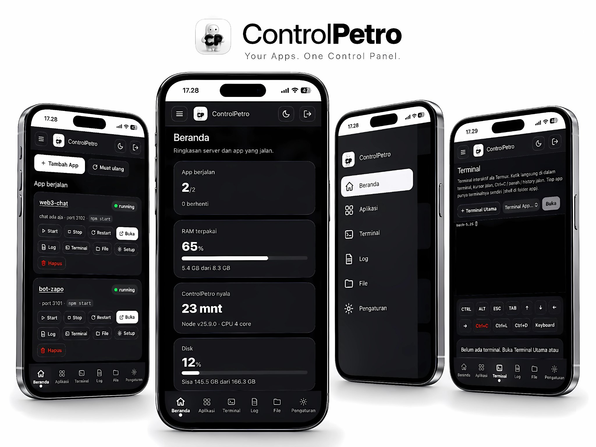
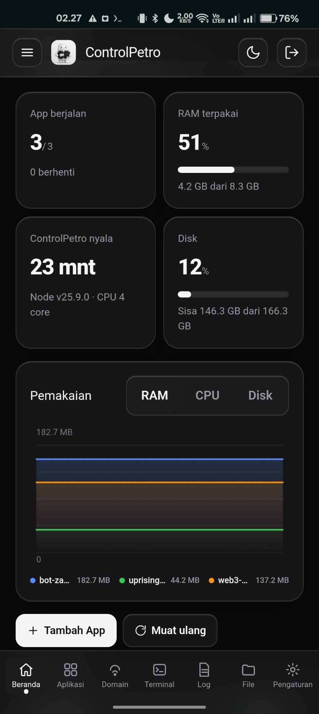
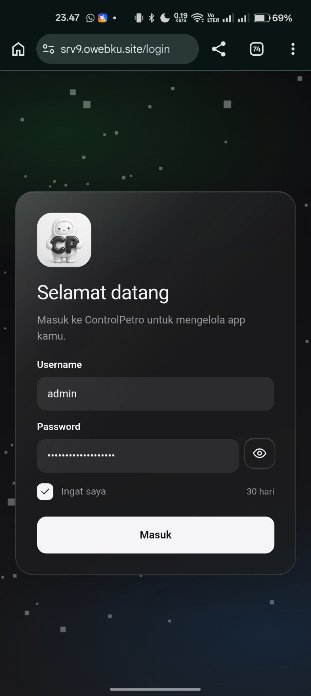

# ControlPetro

[](https://srv9.owebku.site/)
[](#teknologi)
[](#lisensi)

Panel kendali untuk server Pterodactyl. Satu dashboard untuk mengelola semua app di dalam server: menjalankan, menghentikan, memantau, mengedit file, sampai memasang domain sendiri via Cloudflare Tunnel. Tanpa SSH, tanpa panel yang ribet.

> Live demo: **https://srv9.owebku.site/** (halaman landing publik, login untuk masuk dashboard)



## Tampilan

### Beranda



### Login



## Fitur

- **Dashboard** — Beranda dengan grid statistik (app berjalan, RAM terpakai, uptime, disk) dalam 2 kolom, efek Liquid Glass ala iOS, tema terang/gelap.
- **Pemakaian (monitoring live)** — Grafik gelombang ala Task Manager di Beranda. Satu gelombang per app, pilih metrik RAM / CPU / Disk. Riwayat 2 menit terakhir disimpan di bridge (file `monitor-history.json`), jadi refresh halaman tidak membuat grafik mulai dari kosong.
- **Wizard Tambah App 3 langkah** — 1 Project (sumber Git / Upload / Kosong), 2 Instalasi (deteksi dependensi, install command yang bisa diedit, log live), 3 Deploy (start/build command, port auto/manual, environment, autostart). App dibuat berhenti dulu, baru jalan setelah deploy.
- **Terminal per app** — xterm.js gaya Termux: ketik langsung di terminal, output ANSI berwarna, toolbar CTRL/ALT sticky, ESC, TAB, panah, Ctrl+C/L/D. Tiap app punya terminalnya sendiri (shell di folder app), plus Terminal Utama di menu Terminal.
- **File Manager** — Gaya iOS: breadcrumb, baca/tulis/edit, hapus, rename, upload (multipart, sampai 100 MB), editor permission (checkbox 3x3 + octal). Klik kartu app langsung masuk ke file manager app tersebut.
- **Toggle Publik per app** — App bisa dibuka siapa saja tanpa login (cocok untuk game/statis), atau tetap private (butuh login). Dashboard selalu butuh login.
- **Backup custom** — Bottom sheet dari bawah: centang Sistem, Password, Domain, dan app mana saja yang ikut. Total ukuran tampil live. Hasilnya arsip ZIP (fallback TAR.GZ) yang bisa di-restore dengan cara extract lalu start — password ikut, tunnel token ikut, API token Cloudflare tidak ikut.
- **Menu Domain** — Pasang custom domain lewat Cloudflare Tunnel tanpa app cloudflared terpisah. Paste API token Cloudflare sekali, pilih zone, isi subdomain, sisanya otomatis: tunnel dibuat, ingress diatur, DNS CNAME dibuat, tunnel jalan sebagai layanan sistem. Ada status, log, restart, ganti domain, dan putuskan domain.
- **App statis otomatis** — App yang hanya berisi file HTML (misal `index.html` atau satu file `.html`) langsung disajikan sebagai web statis, tanpa perlu file server per app.
- **Halaman error HTML** — Browser yang membuka path terlarang/tidak ketemu dapat halaman error ControlPetro (kode besar, ikon, tombol Masuk), bukan JSON mentah. Client API tetap dapat JSON.
- **Landing page** — Halaman publik di `/` untuk pengunjung yang belum login, dengan tombol Masuk di header. Sudah login langsung diarahkan ke dashboard.

## Cara install (lokal / VPS)

Prasyarat: Node.js 20+ dan npm.

```bash
git clone https://github.com/FAHMYZAR/ControlPetro.git
cd ControlPetro

# 1. Backend (hanya butuh express)
npm --prefix server install

# 2. Frontend (build sekali, hasilnya di frontend/dist/)
npm --prefix frontend install
npm --prefix frontend run build

# 3. Konfigurasi (opsional, lihat .env.example)
cp .env.example .env

# 4. Jalankan
node run.cjs
```

Buka `http://127.0.0.1:5013/` — tanpa login tampil landing page, `/login` untuk masuk dashboard.

## Cara deploy di Pterodactyl

1. Upload isi repo ini ke folder server (misal ke `v3/`, sesuai setup live).
2. Set **Startup Command (CMD_RUN)** menjadi:
   - `node v3/run.cjs` — kalau repo ditaruh di folder `v3/`
   - `node run.cjs` — kalau repo ditaruh di root container
3. Start server. Launcher (`run.cjs`) akan `npm install` express bila belum ada, lalu menjalankan backend.
4. Buka alokasi server. Login pertama: lihat password di file `.env` lewat File Manager panel (password dibuat otomatis saat pertama jalan bila belum diisi), atau isi `BRIDGE_PASSWORD` di `.env` sebelum start.

Catatan: `CMD_RUN` harus satu perintah node saja, tanpa `&&` (egg Pterodactyl menambahkan prefix `/usr/local/bin/` sehingga operator shell gagal).

## Konfigurasi

Konfigurasi dibaca dari environment atau file `.env` (lihat `.env.example`):

| Variabel | Default | Keterangan |
| --- | --- | --- |
| `BRIDGE_PASSWORD` | (auto-generate) | Password login dashboard. Min. 8 karakter. |
| `BRIDGE_USER` | `admin` | Username login dashboard. |
| `PORT` / `SERVER_PORT` | `5013` | Port bridge. Ikuti alokasi panel Pterodactyl. |

App yang dikelola disimpan di `server/apps.json` dan folder `server/apps/<nama>/`. Domain/tunnel disimpan di `server/domain.json` (mode 600, berisi token tunnel — jangan dibagikan). Riwayat monitoring disimpan di `server/monitor-history.json`.

## Struktur repo

```
ControlPetro/
├── run.cjs                  # Launcher (stdlib-only): install express bila perlu, lalu jalanin server
├── .env.example             # Contoh konfigurasi (salin jadi .env)
├── landing/
│   └── index.html           # Landing page publik (self-contained)
├── server/
│   ├── server.cjs           # Express backend: supervisor app, proxy, terminal, file manager, backup, domain
│   ├── static-server.cjs    # Server file statis untuk app HTML
│   ├── apps.json            # Registry app (nama, port, command, autostart, public)
│   └── apps/                # Folder tiap app (hello + demo sebagai contoh)
├── frontend/
│   ├── src/                 # Svelte + Tailwind (Login, Home, Apps, Terminal, File, Log, Domain, Settings)
│   └── public/              # Favicon + logo
└── docs/
    └── images/              # Screenshot untuk README ini
```

## Keamanan

- **Session-only.** Login memakai session cookie (token 256-bit, HttpOnly, SameSite=Lax). Basic Auth tidak dipakai.
- **Rate-limit login.** 5x gagal per IP per 5 menit, lalu `429`.
- **Perbandingan timing-safe** untuk username/password.
- **Password dan token tidak pernah di-commit.** `.env`, `server/domain.json`, `server/monitor-history.json`, dan `**/token.txt` sudah ada di `.gitignore`. File backup yang berisi password jangan dibagikan sembarangan.
- **HTTPS.** Untuk login yang aman, jalankan di balik HTTPS (misal lewat menu Domain / Cloudflare Tunnel). Jangan login lewat HTTP dari WiFi publik.
- **Scope file manager.** Hanya `server/apps/` dan `server/apps.json` yang bisa diakses. Path traversal, `.env`, `node_modules`, dan symlink keluar diblokir.

## Lisensi

MIT.
